# ai-eu-trade-accelerator

A source-first content-audit pipeline that compares official UK guidance against the
underlying law. The pipeline starts with **Scope Planner**, branches into a **guidance path**
and a **law path**, recombines at **Proposition Matcher**, re-adjudicates at **Match Adjudicator**, and
finishes with **Audit Assembler**.

**How to run:** see [RUNBOOK.md](RUNBOOK.md) for prerequisites and step-by-step commands.

Historic personal codenames (Scope Planner, Guidance Discovery, …) are documented in [NAMES.md](NAMES.md).
Compatibility contract: [docs/migration-component-rename.md](docs/migration-component-rename.md).
Machine-readable mapping: [`components.manifest.yaml`](components.manifest.yaml).

## Pipeline

Canonical end-to-end process view (D2; regenerate with `just diagrams`):

Stage table, pair vs aggregate comparison model, and walkthrough: [docs/architecture/pipeline.md](docs/architecture/pipeline.md).

Source: [`docs/diagrams/pipeline/end-to-end.d2`](docs/diagrams/pipeline/end-to-end.d2).
## Components

<!-- BEGIN COMPONENT TABLE -->
| Canonical name | Slug | Legacy codename | Responsibility |
| --- | --- | --- | --- |
| **Scope Planner** | `scope-planner` | Grace | Select the audit category and develop its operational scope definition |
| **Guidance Discovery** | `guidance-discovery` | Mary | Find potentially in-scope GOV.UK guidance pages and retrieve their source content |
| **Law Discovery** | `law-discovery` | Ada | Find candidate legal instruments, rank them and support human selection or review |
| **Guidance Relevance Filter** | `guidance-relevance-filter` | Radia | Narrow the guidance corpus to pages substantively relevant to the audit scope |
| **Guidance Proposition Extractor** | `guidance-proposition-extractor` | Susan | Convert guidance content into atomic guidance propositions |
| **Law Proposition Extractor** | `law-proposition-extractor` | Judit | Convert legislation into atomic legal propositions and associated legal structure |
| **Proposition Matcher** | `proposition-matcher` | Beatrice | Retrieve legal candidates for each guidance proposition and classify their relationships |
| **Match Adjudicator** | `match-adjudicator` | Anna | Reassess flagged or uncertain findings using broader guidance and legal context |
| **Audit Assembler** | `audit-assembler` | Esther | Join completed pipeline outputs and prepare the audit representation consumed by the frontend |
<!-- END COMPONENT TABLE -->

Other maintained documents should link here rather than reproducing this full mapping.

## Architecture

C4 system context and containers (D2 + committed SVGs): [docs/architecture/](docs/architecture/).

Diagram sources and regenerate command (`just diagrams`): [docs/diagrams/](docs/diagrams/).

## Steps

| Step | Path | What it does |
| --- | --- | --- |
| **Scope Planner** | Entry | Manual topic/category scope; branches into the two paths. |
| **Guidance Discovery** | Guidance | GOV.UK search + content APIs — discovers candidate guidance. |
| **Guidance Relevance Filter** | Guidance | Labels pages for on-topic relevance to the audit scope. |
| **Guidance Proposition Extractor** | Guidance | Generates guidance propositions from on-topic pages. |
| **Law Discovery** | Law | Lex legislation search — discovers candidates; human accept/park. |
| **Law Proposition Extractor** | Law | Generates law propositions from selected legislation. |
| **Proposition Matcher** | Merge | Pair-level relationships plus guidance-proposition aggregate status. |
| **Match Adjudicator** | Merge | Re-adjudicates flagged top matches with page context. |
| **Audit Assembler** | Output | Joins outputs into the audit representation for the frontend. |

## Previous run (topic: "slurry")

Input size, runtime, and cost from the end-to-end "slurry" run (2026-06-25). Scope Planner was a manual
step; Law Discovery returned **5** legislation results, which became Law Proposition Extractor's input.
Guidance Discovery / Law Discovery / Law Proposition Extractor inputs were reused from the prior fetch
(not re-run this pass). Costs are batch-API actuals from each step's `metrics.json`;
**Law Proposition Extractor** does not record token cost, and Guidance Discovery / Audit Assembler
make no LLM calls.

| Step | Input size | Runtime | Cost |
| --- | --- | --- | --- |
| **Scope Planner** | "slurry" (category) | Manual | Manual |
| **Guidance Discovery** | → 18,487-page corpus | reused | $0 (public API) |
| **Guidance Relevance Filter** | 18,487 pages → 126 on-topic | ~42 min | $3.72 |
| **Guidance Proposition Extractor** | 126 pages → 83 extracted (2,307 propositions) | ~4 min | $6.31 |
| **Law Discovery** | legislation.gov.uk → 5 results | reused | — |
| **Law Proposition Extractor** | 5 law results → 678 propositions | reused | Unknown (to backfill) |
| **Proposition Matcher** | 2,307 guidance × 678 law propositions | ~17 min | $13.48 |
| **Match Adjudicator** | 33 flagged findings | ~2 min | $0.12 |
| **Audit Assembler** | 83 audited pages | ~2 min | $0 (no LLM) |
| **Total** | 126 audited / 83 extracted | — | **≈ $23.63**¹ |

¹ Sum of recorded LLM costs (Guidance Relevance Filter + Guidance Proposition Extractor +
Proposition Matcher + Match Adjudicator). Excludes Law Proposition Extractor (cost not
recorded) and Guidance Discovery / Audit Assembler (no LLM calls).

## Directories

Each step lives in its own directory:

- **Scope Planner** — category search / optimization (manual; see [RUNBOOK.md](RUNBOOK.md))
- [`guidance-discovery/`](guidance-discovery/) — GOV.UK search API
- [`guidance-relevance-filter/`](guidance-relevance-filter/) — relevance scoring
- [`guidance-proposition-extractor/`](guidance-proposition-extractor/) — generate guidance propositions
- [`law-discovery/`](law-discovery/) — legislation.gov.uk search
- [`law-proposition-extractor/`](law-proposition-extractor/) — generate law propositions
- [`proposition-matcher/`](proposition-matcher/) — conflict and gap analysis
- [`match-adjudicator/`](match-adjudicator/) — re-adjudicate flagged findings with page context
- [`audit-assembler/`](audit-assembler/) — join outputs for the frontend

## Infographic

The polished pipeline infographic is generated from a shared prompt template:

- [`law-proposition-extractor/docs/assets/infographics/prompt-template.md`](law-proposition-extractor/docs/assets/infographics/prompt-template.md)
