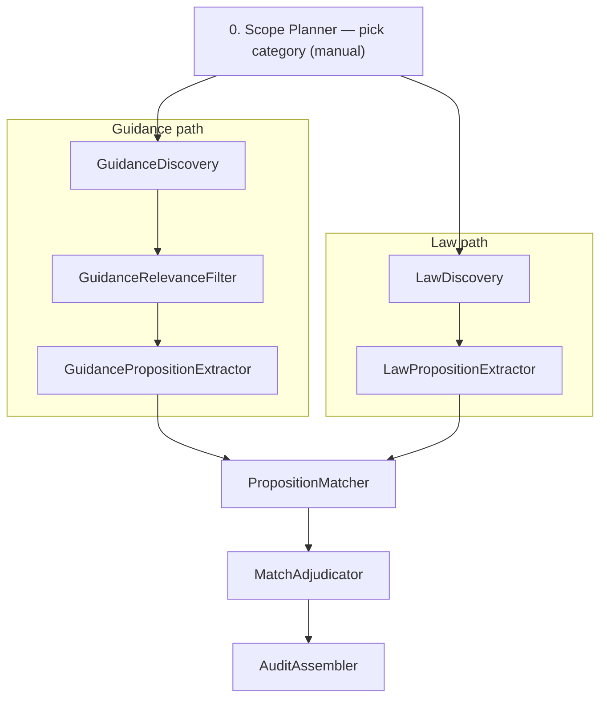

# Runbook — ai-eu-trade-accelerator

End-to-end operator guide for the content-audit pipeline. Each step is a **standalone**
`uv` project; there is no root orchestrator. Steps hand off JSON artifacts manually.

See [README.md](README.md) for the pipeline diagram and the canonical [component table](README.md#components). Historic names: [NAMES.md](NAMES.md). Migration: [docs/migration-component-rename.md](docs/migration-component-rename.md). Architecture (C1/C2 D2 + dependency matrix): [docs/architecture/](docs/architecture/).

## Pipeline order

Canonical process diagram (D2 SVG): [docs/diagrams/generated/pipeline/end-to-end.svg](docs/diagrams/generated/pipeline/end-to-end.svg)  
Walkthrough and stage table: [docs/architecture/pipeline.md](docs/architecture/pipeline.md).

Operator sketch (stage order only):



| Step | Directory | LLM / services | Typical input | Typical output |
| --- | --- | --- | --- | --- |
| **Scope Planner** | — | Manual | Topic / category brief | Category JSON for Law Discovery; Guidance Relevance Filter category data |
| **Guidance Discovery** | [`guidance-discovery/`](guidance-discovery/) | None (public gov.uk APIs) | — | `output/with_body.json` + `funnel.json` |
| **Guidance Relevance Filter** | [`guidance-relevance-filter/`](guidance-relevance-filter/) | Anthropic | Guidance Discovery's corpus | `output.json` + `funnel.json` (every URL stamped with drop stage) |
| **Guidance Proposition Extractor** | [`guidance-proposition-extractor/`](guidance-proposition-extractor/) | Anthropic | Guidance Relevance Filter on-topic pages | `output.json` + `funnel.json` (extracted / excluded URLs) |
| **Law Discovery** | [`law-discovery/`](law-discovery/) | Lex (+ optional LiteLLM) | Category brief | Law Proposition Extractor intake source bundle |
| **Law Proposition Extractor** | [`law-proposition-extractor/`](law-proposition-extractor/) | LiteLLM → Anthropic/Ollama | Law Discovery intake bundle | `propositions.json`, `proposition_matcher_law_candidates.json` |
| **Proposition Matcher** | [`proposition-matcher/`](proposition-matcher/) | Ollama + Anthropic | Guidance Proposition Extractor + Law Proposition Extractor outputs | `results.json` (pair + aggregate status) |
| **Match Adjudicator** | [`match-adjudicator/`](match-adjudicator/) | Anthropic | Proposition Matcher run | Proposition Matcher-shaped `results.json` |
| **Audit Assembler** | [`audit-assembler/`](audit-assembler/) | None | Match Adjudicator + Guidance Relevance Filter + seeds | Frontend audit data |

## Prerequisites

Full per-step dependency matrix (LLM path, HTTP APIs, state): [docs/architecture/dependencies.md](docs/architecture/dependencies.md).

Install once:

| Tool | Used by |
| --- | --- |
| [uv](https://docs.astral.sh/uv/) | All steps |
| **Python 3.13+** | `law-proposition-extractor/`, `proposition-matcher/` (others accept ≥3.12; use 3.13 everywhere) |
| `ANTHROPIC_API_KEY` | Guidance Relevance Filter, Guidance Proposition Extractor, Proposition Matcher, Match Adjudicator |
| [Ollama](https://ollama.com/) + `nomic-embed-text:v1.5` | Proposition Matcher embeddings |
| LiteLLM proxy (`just litellm` in `law-proposition-extractor/`) | Law Discovery AI features, Law Proposition Extractor LLM extraction |
| `LAW_DISCOVERY_LEX_BASE_URL` (+ optional key) | Law Discovery live legislation discovery |
| `just`, Node.js | Optional — Law Proposition Extractor web UI only |

External repos referenced in step READMEs (not vendored here):

- **`content-audit-data-assets`** — canonical home for run artifacts between steps
- **`ai-sdlc-content-audit`** — Audit Assembler output destination (frontend)
- **`audit-assembler/seeds`** — manually maintained law catalogue (`categories.json`, `legislation.json`, `legislation-propositions.json`)

### Run directory convention

```bash
export DATA=../content-audit-data-assets/steps   # or any writable path
mkdir -p "$DATA"/{guidance-discovery,guidance-relevance-filter,guidance-proposition-extractor,law-discovery,law-proposition-extractor,proposition-matcher,match-adjudicator,audit-assembler}
```

Each step: `cd <step> && uv sync`. Law Proposition Extractor also: `cd law-proposition-extractor && just setup`.

---

## 0. Scope Planner — category selection (manual)

Scope Planner has **no code in this repo**. It is the manual step where you choose what to audit
and prepare the category brief that branches into the guidance and law paths.

For the shipped **slurry** example:

- Law Discovery category brief: [`law-discovery/examples/categories/slurry_manure_agricultural_effluent.category.json`](law-discovery/examples/categories/slurry_manure_agricultural_effluent.category.json)
- Guidance Relevance Filter bakes in the **slurry** category (`guidance-relevance-filter/src/guidance-relevance-filter/data/categories.json` +
  `lexicon.json`). A new topic requires new Guidance Relevance Filter category data files.

The two paths below can run **in parallel** once Scope Planner is done.

---

## Guidance path

### 1. Guidance Discovery — fetch DEFRA guidance corpus

No API keys. Full corpus build is ~18k pages and ~30 minutes (body fetch is the wait).

```bash
cd guidance-discovery
uv sync
./run.sh
# → output/search_api.json   (metadata only)
# → output/with_body.json    (Guidance Relevance Filter input)
# → output/funnel.json       (fetch_failed / body_empty / chapters_expanded URL lists)
```

Stages individually:

```bash
uv run python src/get_defra_guidance_pages.py   # → output/search_api.json
uv run python src/fetch_body.py                 # → output/with_body.json + output/funnel.json
```

Stage 2 is restartable — already-fetched URLs are skipped on re-run.

### 2. Guidance Relevance Filter — filter to on-topic pages

```bash
cd guidance-relevance-filter
uv sync
export ANTHROPIC_API_KEY=sk-...

uv run guidance-relevance-filter run \
  ../guidance-discovery/output/with_body.json \
  "$DATA/guidance-relevance-filter/runs/my-topic/"
# → output.json, adjudication.json, funnel.json, metrics.json, MODEL.md
```

Pages must carry `meta_data.body_text` (Guidance Discovery provides this). Guidance Relevance Filter drops `body_text`
from its output.

Reference slurry run (2026-06-25): ~42 min, ~$3.72.

Annotate a gold URL list with the drop stage and reason (or `not_in_corpus` if the URL never reached the filter):

```bash
uv run guidance-relevance-filter explain \
  path/to/urls.csv \
  "$DATA/guidance-relevance-filter/runs/my-topic/" \
  -o path/to/urls-funnel.csv \
  --url-column "Original URL"

# Same join without the CLI: upload the CSV + funnel.json / output.json
uv sync --group web
uv run guidance-relevance-filter serve
```

Operator UI (category wizard, routed-page cap, email when the Anthropic job finishes, Excel → GPE `pages.json`): [`guidance-relevance-web/README.md`](guidance-relevance-web/README.md). The CLI path above is unchanged.

### 3. Guidance Proposition Extractor — extract guidance propositions

```bash
cd guidance-proposition-extractor
uv sync
export ANTHROPIC_API_KEY=sk-...

# Map Guidance Relevance Filter output → Guidance Proposition Extractor pages input ({url, title, content_id})
uv run guidance-proposition-extractor prepare \
  "$DATA/guidance-relevance-filter/runs/my-topic/output.json" \
  "$DATA/guidance-proposition-extractor/pages.json" \
  --category slurry
# → pages.json + sibling funnel.json (kept vs dropped_not_on_topic, with upstream stage + reasons)

# Extract (Guidance Proposition Extractor re-fetches page bodies from gov.uk)
uv run guidance-proposition-extractor run \
  "$DATA/guidance-proposition-extractor/pages.json" \
  "$DATA/guidance-proposition-extractor/runs/my-topic/"
# → output.json (content_id + propositions with source_paragraphs / section_locators),
#   excluded.json, funnel.json (extracted / excluded / not_yet_processed URL lists),
#   metrics.json (incl. source_paragraph_verbatim_misses), MODEL.md
```

Guidance Proposition Extractor is resumable. Long pages may land in `excluded.json` as `too_big` — re-run with
a higher token cap:

```bash
uv run guidance-proposition-extractor run "$DATA/guidance-proposition-extractor/pages.json" "$DATA/guidance-proposition-extractor/runs/my-topic/" \
  --retry-excluded --max-tokens 32000
```

`proposition_text` is a **derived** rewrite for matching; pin back to the page via
`source_paragraphs` (and post-hoc `section_locators`). Matching downstream embeds
`proposition_text` only.

Reference slurry run: ~4 min, ~$6.31.

---

## Law path

### 4. Law Discovery — discover, review, export for Law Proposition Extractor

```bash
cd law-discovery
uv sync
cp .env.example .env   # when using Lex or LiteLLM
```

**Offline smoke** (no Lex, no LLM):

```bash
uv run law-discovery build-query-plan examples/equine-identification.category.json \
  --output /tmp/query-plan.json

uv run law-discovery discover examples/equine-identification.category.json \
  --output /tmp/discovery-run.json --no-network

uv run law-discovery make-register /tmp/discovery-run.json \
  --output /tmp/source-register.json

uv run law-discovery export-for-law-proposition-extractor /tmp/source-register.json \
  --output /tmp/handoff.json
```

**Slurry (Lex-backed)** — review candidates before export:

```bash
export LAW_DISCOVERY_LEX_BASE_URL=...
export LAW_DISCOVERY_LEX_API_KEY=...   # if required

uv run law-discovery discover \
  examples/categories/slurry_manure_agricultural_effluent.category.json \
  --output runs/slurry_manure_agricultural_effluent/discovery-run.json

uv run law-discovery-viewer runs/slurry_manure_agricultural_effluent/discovery-run.json

uv run law-discovery make-register runs/slurry_manure_agricultural_effluent/discovery-run.json \
  --output runs/slurry_manure_agricultural_effluent/source-register.json

# Richer handoff (source bundle with relationships):
uv run law-discovery export-bundle-for-law-proposition-extractor \
  runs/slurry_manure_agricultural_effluent/source-bundle-reviewed.json \
  --output runs/slurry_manure_agricultural_effluent/source-bundle-law-proposition-extractor-intake-gb-principal-5.json
```

A reviewed slurry bundle is committed at
[`law-discovery/runs/slurry_manure_agricultural_effluent/source-bundle-law-proposition-extractor-intake-gb-principal-5.json`](law-discovery/runs/slurry_manure_agricultural_effluent/source-bundle-law-proposition-extractor-intake-gb-principal-5.json).

Law Discovery does **not** guarantee legal completeness — human review is required before export.

### 5. Law Proposition Extractor — intake and law proposition extraction

```bash
cd law-proposition-extractor
just setup
cp .env.example .env   # LAW_PROPOSITION_EXTRACTOR_LLM_*, LITELLM_MASTER_KEY
```

**Smoke (no LLM)** — heuristic extraction on the demo case:

```bash
uv run --package law-proposition-extractor-pipeline python -m law_proposition_extractor_pipeline export-case \
  data/demo/example_case.json \
  --output-dir dist/demo-export \
  --derived-cache-dir "$(mktemp -d)" \
  --extraction-mode heuristic
```

**Production slurry path** — needs LiteLLM + Anthropic for `frontier` extraction:

```bash
# Terminal 1 — ensure ANTHROPIC_API_KEY is set for frontier_extract
just litellm

# Terminal 2
uv run --package law-proposition-extractor-pipeline python -m law_proposition_extractor_pipeline run-bundle \
  ../law-discovery/runs/slurry_manure_agricultural_effluent/source-bundle-law-proposition-extractor-intake-gb-principal-5.json \
  --output "$DATA/law-proposition-extractor/runs/slurry-case/" \
  --use-llm \
  --extraction-mode frontier

uv run --package law-proposition-extractor-pipeline python -m law_proposition_extractor_pipeline export-run \
  "$DATA/law-proposition-extractor/runs/slurry-case/" \
  --output-dir "$DATA/law-proposition-extractor/runs/slurry-export/"
# → propositions.json, proposition_matcher_law_candidates.json (preferred Proposition Matcher --law),
#   plus full artifact bundle
```

Inspect quality:

```bash
uv run --package law-proposition-extractor-pipeline python -m law_proposition_extractor_pipeline lint-export \
  --export-dir "$DATA/law-proposition-extractor/runs/slurry-export/"
```

A committed slurry export lives at
[`law-proposition-extractor/runs/slurry-gb-principal-5-current-export/`](law-proposition-extractor/runs/slurry-gb-principal-5-current-export/).

**Optional — Law Proposition Extractor web workbench** (separate terminals):

```bash
just api    # FastAPI on http://127.0.0.1:8010
just web    # Next.js dev server
```

See [`law-proposition-extractor/docs/dev/llm-extraction-local-mode.md`](law-proposition-extractor/docs/dev/llm-extraction-local-mode.md)
for LiteLLM wiring and common errors.

---

## Merge and finish

### 6. Proposition Matcher — match guidance against law

Requires Ollama serving embeddings and an Anthropic key for group-rerank + summarise.

```bash
cd proposition-matcher
uv sync
cp .env.example .env
ollama pull nomic-embed-text:v1.5
# ensure `ollama serve` is running

./run.sh run \
  --guidance "$DATA/guidance-proposition-extractor/runs/my-topic/output.json" \
  --law      "$DATA/law-proposition-extractor/runs/slurry-export/proposition_matcher_law_candidates.json" \
  --out      "$DATA/proposition-matcher/runs/my-topic/"
# → results.json (keeps content_id, source_paragraphs, section_locator, law_source
#   alongside derived proposition_text + matches), results.csv, metrics.json, MODEL.md
#
# Raw propositions still work (auto-detect or --law-source propositions):
#   --law "$DATA/law-proposition-extractor/runs/slurry-export/propositions.json"
```

Dry-run (embed + retrieve only, no Anthropic spend):

```bash
./run.sh run --guidance ... --law ... --out ... --dry-run
```

Reference slurry run: ~17 min, ~$13.48.

### 7. Match Adjudicator — re-adjudicate flagged findings

Match Adjudicator reads Proposition Matcher `results.json`, re-judges top matches flagged `CONFLICTS` or
`GUIDANCE_INCOMPLETE` with full page context, and writes a Proposition Matcher-shaped run for Audit Assembler.

```bash
cd match-adjudicator
uv sync
export ANTHROPIC_API_KEY=sk-...

uv run match-adjudicator readjudicate \
  --proposition-matcher-run "$DATA/proposition-matcher/runs/my-topic" \
  --dest         "$DATA/match-adjudicator/runs/my-topic" \
  --dry-run

# Drop --dry-run to submit the batch and write the run
```

Reference slurry run: ~2 min, ~$0.12.

### 8. Audit Assembler — build frontend audit data

No LLM. Joins upstream outputs into the shape consumed by the content-audit frontend.

```bash
cd audit-assembler
uv sync

uv run audit-assembler build \
  --proposition-matcher-run  "$DATA/match-adjudicator/runs/my-topic" \
  --input-pair    "$DATA/proposition-matcher/inputs/my-pair" \
  --relevance-filter-run     "$DATA/guidance-relevance-filter/runs/my-topic/output.json" \
  --seeds         "$DATA/audit-assembler/seeds" \
  --dest          ../../ai-sdlc-content-audit/src/server/services/audit/data \
  --reading-age-cache ../../reading-age/cache \
  --dry-run
```

`--input-pair` is a directory containing `law.json` (Law Proposition Extractor propositions). Seeds live
outside this repo. Drop `--dry-run` to write files. `build` also writes `pairs.csv` into `--dest`
for the frontend download; for a packed envelope run, also:

```bash
uv run audit-assembler export-csv \
  --input "$DATA/audit-assembler/runs/my-topic/output.json"
```

Reference slurry run: ~2 min, $0 (no LLM).

---

## Slurry reference run (2026-06-25)

Costs are batch-API actuals from each step's `metrics.json` where recorded.

| Step | Input | Runtime | Cost |
| --- | --- | --- | --- |
| Scope Planner | "slurry" (category) | Manual | Manual |
| Guidance Discovery | → 18,487-page corpus | reused | $0 |
| Guidance Relevance Filter | 18,487 → 126 on-topic | ~42 min | $3.72 |
| Guidance Proposition Extractor | 126 → 83 extracted (2,307 propositions) | ~4 min | $6.31 |
| Law Discovery | legislation.gov.uk → 5 results | reused | — |
| Law Proposition Extractor | 5 law results → 678 propositions | reused | Not recorded |
| Proposition Matcher | 2,307 × 678 propositions | ~17 min | $13.48 |
| Match Adjudicator | 33 flagged findings | ~2 min | $0.12 |
| Audit Assembler | 83 audited pages | ~2 min | $0 |
| **Total** | 126 audited / 83 extracted | — | **≈ $23.63** |

Excludes Law Proposition Extractor (cost not backfilled) and Guidance Discovery/Audit Assembler (no LLM calls).

---

## Quick smoke tests

Validate individual steps without running the full ~18k-page corpus:

| Step | Command | Notes |
| --- | --- | --- |
| Law Proposition Extractor | Heuristic `export-case` on `data/demo/example_case.json` | ~30 s, no API keys |
| Guidance Discovery | Stage 1 only: `uv run python src/get_defra_guidance_pages.py` | Metadata only, seconds |
| Law Discovery | `--no-network` discover workflow (above) | No Lex or LLM |
| Proposition Matcher / Match Adjudicator / Audit Assembler | Need real Guidance Proposition Extractor + Law Proposition Extractor outputs | Reuse committed slurry artifacts under `law-proposition-extractor/runs/` |

---

## Per-step documentation

| Step | README |
| --- | --- |
| Guidance Discovery | [`guidance-discovery/README.md`](guidance-discovery/README.md) |
| Guidance Relevance Filter | [`guidance-relevance-filter/README.md`](guidance-relevance-filter/README.md) |
| Guidance Relevance Filter operator UI | [`guidance-relevance-web/README.md`](guidance-relevance-web/README.md) |
| Guidance Proposition Extractor | [`guidance-proposition-extractor/README.md`](guidance-proposition-extractor/README.md) |
| Law Discovery | [`law-discovery/README.md`](law-discovery/README.md) |
| Law Proposition Extractor | [`law-proposition-extractor/README.md`](law-proposition-extractor/README.md) |
| Proposition Matcher | [`proposition-matcher/README.md`](proposition-matcher/README.md) |
| Match Adjudicator | [`match-adjudicator/README.md`](match-adjudicator/README.md) |
| Audit Assembler | [`audit-assembler/README.md`](audit-assembler/README.md) |
