# C1 — System context

Canonical source: [`docs/diagrams/architecture/c1-system-context.d2`](../diagrams/architecture/c1-system-context.d2)  
Generated SVG (committed): 

Regenerate with `just diagrams` from the repository root.

## What this view answers

- Who uses Guidance to Law Comparison?
- What does the system broadly do?
- Where do guidance, legislation, and model inference come from?

It does **not** show pipeline stages, packages, the filesystem handoff store, or the audit presentation UI — those are below C1 (see [C2](c2-containers.md)).

## What Guidance to Law Comparison does

Guidance to Law Comparison (this repository’s content-audit pipeline) compares official UK guidance with the underlying law for a chosen audit topic. Operators define scope and run the comparison; reviewers interpret the comparison results. Where the review UI lives is a container detail on C2.

The current product compares **guidance with law**. A broader directional proposition-comparison model is being explored as an architectural direction — it is **not** how the running system is parameterised today. See [Proposition comparison abstraction](proposition-comparison.md).

## What this system does not own

- No shared database or object store for cross-step handoff (filesystem artifacts live inside the container view)
- No root workflow engine — operators run standalone steps

## People and external systems

| Party | Role |
| --- | --- |
| Operator | Defines audit scope and runs the comparison |
| Reviewer | Interprets comparison results |
| GOV.UK | Supplies official guidance |
| UK legislation sources | Lex (search) and legislation.gov.uk (authoritative text) — separated on C2 |
| Model services | Cloud and local language / embedding models. C2 aggregates this to the Guidance to Law Comparison boundary; per-step routing is in [dependencies.md](dependencies.md) |

## Next

- Containers: [c2-containers.md](c2-containers.md)
- Process journey: [pipeline.md](pipeline.md)
- Proposition comparison abstraction: [proposition-comparison.md](proposition-comparison.md)
- Keys / services matrix: [dependencies.md](dependencies.md)
