# C2 — Containers

Canonical source: [`docs/diagrams/architecture/c2-containers.d2`](../diagrams/architecture/c2-containers.d2)  
Generated SVG (committed): 

Regenerate with `just diagrams` from the repository root.

This is a C4-style container view of the current Guidance → Law implementation. It groups runtime responsibilities rather than showing full execution order; see the end-to-end pipeline diagram for stage sequencing.

C2 is treated as final unless future architecture changes require it to be updated.

## What this view answers

- Where do the major runtime responsibilities live?
- How are those responsibilities grouped inside the Guidance to Law Comparison software-system boundary?
- Which people and external systems interact with which areas?
- Where do shared artefacts and the review UI sit?

It does **not** answer “what happens, and in what order?” — that is the [pipeline](pipeline.md) view.

C2 groups containers by responsibility:

| Area | Contains |
| --- | --- |
| Guidance processing | Discovery, Relevance Filter, Proposition Extractor |
| Law processing | Discovery, Proposition Extractor |
| Comparison and review | Matcher, Adjudicator, Assembler |
| Shared infrastructure | Filesystem artifact store |
| Presentation | Audit frontend |

For **stage ordering and artefacts**, use the process view — not this page:

- [pipeline.md](pipeline.md) · [end-to-end.svg](../diagrams/generated/pipeline/end-to-end.svg)

For **keys and per-step LLM routing**, see [dependencies.md](dependencies.md).

## Intentionally aggregated: Model services

Several model-backed containers use external inference (Relevance Filter, both extractors, Matcher, Adjudicator; Law Discovery optionally). Drawing those edges individually would crowd the diagram.

The C2 diagram therefore keeps a single **Model services → Guidance to Law Comparison boundary** relationship (`provides inference`) for readability. That edge is an aggregation, not a claim that the software-system boundary is a runtime container. Per-step routing stays in [dependencies.md](dependencies.md).

## Match Adjudicator is not an unavoidable hop

Adjudicator is in the normal [RUNBOOK](../../RUNBOOK.md) path. Assembler can also consume Matcher output directly because the result schemas align.

C2 keeps the thin `Matcher → Adjudicator → Assembler` sequence as that usual grouping. It is visually secondary and is **not** a branching process diagram. Execution alternatives belong in [pipeline.md](pipeline.md) / the RUNBOOK.

## Container inventory

| Container | Directory | Responsibility |
| --- | --- | --- |
| Guidance Discovery | `guidance-discovery/` | Find and fetch GOV.UK guidance |
| Guidance Relevance Filter | `guidance-relevance-filter/` | Keep pages on-topic for the audit |
| Guidance Proposition Extractor | `guidance-proposition-extractor/` | Turn guidance into atomic propositions |
| Law Discovery | `law-discovery/` | Find and select candidate legislation |
| Law Proposition Extractor | `law-proposition-extractor/` | Turn legislation into law propositions |
| Proposition Matcher | `proposition-matcher/` | Relate guidance propositions to law propositions |
| Match Adjudicator | `match-adjudicator/` | Re-check uncertain or flagged pair results |
| Audit Assembler | `audit-assembler/` | Join run outputs into frontend audit data |
| Filesystem artifact store | external `content-audit-data-assets` | Shared JSON handoffs between steps |
| Audit frontend | `ai-sdlc-content-audit` (presentation UI) | Presents assembled audit results |

### People (not containers)

C1 shows both people talking to Guidance to Law Comparison. C2 zooms that:

| Actor | Role on C2 |
| --- | --- |
| Operator | Defines audit scope and runs container steps (arrow to the Guidance to Law Comparison system / run entry — no Scope Planner app) |
| Reviewer | Reviews comparison results via Audit frontend |

### Comparison status (pair vs proposition)

The comparison model is **not** a single flat status:

- **Pair level** — each guidance proposition ↔ law proposition relationship (Matcher; Adjudicator re-checks flagged pairs)
- **Proposition level** — aggregate / summary status for a guidance proposition across its law matches (Matcher summaries; Assembler preserves both grains)

C2 shows Matcher as a responsibility card only. Do not read it as “one status per guidance page.” Detail stays in the pipeline / data docs.

Proposition Matcher contains some **reusable directional comparison mechanics** (especially retrieval and one-subject-to-many-reference processing), but its current contracts, prompts, pair vocabulary, and judgement semantics are **Guidance → Law-specific**. It is not a source-agnostic comparison engine. See [Proposition comparison abstraction](proposition-comparison.md).

## Boundary judgements

| Decision | Why |
| --- | --- |
| One container per coded pipeline step | Each is a separately runnable `uv` app with FS handoff |
| Operator / Reviewer as people outside the boundary | Zoom from C1; no Scope Planner application (manual activity only) |
| Audit frontend inside Guidance to Law Comparison / Presentation | Matches C1 zoom; deployable as `ai-sdlc-content-audit`; not shared infrastructure |
| Law Proposition Extractor = one container | Merge-path producer is the CLI pipeline; FastAPI/Next.js are optional operator surfaces (see LPE docs) |
| Artifact store as Shared infrastructure | Persistence/handoff only — not Presentation |
| Minimal proposition/store edges on C2 | Extractors write propositions; Matcher reads them; full handoffs are the pipeline diagram |
| Model services as one external box, edge to the system boundary | Aggregation for readability (see above); the boundary is not a runtime container |
| Unlabeled internal sequences only | Guidance/Law/Comparison order is secondary; exact journey is [end-to-end](../diagrams/generated/pipeline/end-to-end.svg) |
| Thin Matcher → Adjudicator → Assembler sequence | Normal RUNBOOK path; Adjudicator is skippable (see above) |

## C1 consistency

C1 shows one **Guidance to Law Comparison** software system. C2 reveals its internal containers. No C2 container appears as an external peer on C1.

C1’s **UK legislation sources** expands here into **Lex** (search) and **legislation.gov.uk** (source text). C1’s **Model services** stays one external box; C2 keeps that aggregation rather than fanning out per container.

## Remaining C2 limitations

- Artifact-store relationships are a simplified proposition hub, not every filesystem handoff.
- Long store diagonals cross the comparison row; D2 places those labels at edge midpoints. Left as-is to avoid routing spaghetti.
- ~1.18 aspect ratio — denser than C1 by design; do not force C1’s ratio.

## LPE drill-down

Law Proposition Extractor internals (API, runner, registry, caches):

- [System overview](../../law-proposition-extractor/docs/architecture/system-overview.md)
- [Technical architecture diagram](../../law-proposition-extractor/docs/assets/diagrams/README.md)

## Next

- System context: [c1-system-context.md](c1-system-context.md)
- Process journey: [pipeline.md](pipeline.md)
- Proposition comparison abstraction: [proposition-comparison.md](proposition-comparison.md)
- Dependencies: [dependencies.md](dependencies.md)
- Diagram convention: [docs/diagrams/README.md](../diagrams/README.md)
