# End-to-end pipeline

Canonical process view for **Guidance to Law Comparison** (this repository’s content-audit journey).

This is **not** a C4 diagram.

| View | Answers |
| --- | --- |
| [C1 — System context](c1-system-context.md) | Who uses the system; material externals |
| [C2 — Containers](c2-containers.md) | Where runnable responsibilities live |
| **This page — Pipeline** | What happens to guidance and law, in what order, and what information is produced |
| [Proposition comparison abstraction](proposition-comparison.md) | Conceptual generalisation direction (not current capability) |

## Diagram

Canonical source: [`docs/diagrams/pipeline/end-to-end.d2`](../diagrams/pipeline/end-to-end.d2)

This diagram is the **current Guidance → Law implementation** journey.

Regenerate with `just diagrams` from the repository root.

## Stage table

| Stage | What it does | Main input | Main output |
| --- | --- | --- | --- |
| **Scope Planner** (manual) | Choose the audit topic and prepare scope/category data | Topic / brief | Audit scope (category brief + guidance category data) |
| **Discover guidance** | Find and fetch GOV.UK guidance pages | Scope; GOV.UK | Guidance corpus |
| **Filter for relevance** | Keep pages on-topic for the audit | Guidance corpus | On-topic guidance |
| **Extract guidance propositions** | Break on-topic guidance into atomic claims | On-topic guidance | Guidance propositions |
| **Discover legislation** | Find candidate legal instruments | Scope; Lex | Candidate legislation |
| **Accept legislation** (human) | Review and accept/park candidates | Candidate legislation | Selected legislation |
| **Extract law propositions** | Break selected legislation into atomic rules | Selected legislation | Law propositions |
| **Match propositions** | Relate each guidance proposition to law propositions | Guidance + law propositions | Pair-level results **and** guidance-proposition aggregate status |
| **Adjudicate flagged pairs** | Re-check uncertain top matches with page context | Comparison results | Reviewed comparison results |
| **Assemble audit** | Join outputs for the frontend | Reviewed results, **or Matcher results directly** (same `results.json` shape) | Audit pack |
| **Review in frontend** | Humans inspect findings | Audit pack | Decisions / follow-up outside this repo |

Canonical component names and directories: [README component table](../../README.md#components). How to run each step: [RUNBOOK.md](../../RUNBOOK.md).

## How to read the journey

1. **Scope** — an operator defines the audit topic.
2. **Two paths** — guidance and law can proceed in parallel. Guidance is filtered for relevance by model-assisted labelling; law relies on **human accept/park** before extraction (asymmetry is intentional).
3. **Propositions** — comparison is **not** page-vs-document. Both paths produce atomic propositions.
4. **Match** — paths meet. Each guidance↔law **pair** gets its own result; each guidance proposition also gets an **aggregate status** from its set of pairs.
5. **Review and present** — flagged pairs can be re-checked (normal RUNBOOK path); results are assembled into an audit pack for the reviewer. Assembler can also consume Matcher output directly because the schemas align — Adjudicator is not an unavoidable hop.

## Comparison model (pair vs aggregate)

| Level | What it is | Example vocabulary |
| --- | --- | --- |
| **Pair** | One guidance proposition ↔ one law proposition | `GROUNDED`, `CONFLICTS`, `GUIDANCE_INCOMPLETE`, `GUIDANCE_BROADER`, `GUIDANCE_MISSING`, `UNGROUNDED` |
| **Guidance proposition** | Overall status derived from that proposition’s pairs | `assessment_status` (`COMPLETE`, `PARTIAL`, `FAILED`, `NOT_CHECKED`) and, when complete, `coverage_result` (e.g. has reportable comparison / only ungrounded / no candidates) |

A guidance proposition may relate to **many** law propositions, conflict with some, miss others, or find none. Do not read the pipeline as “one guidance proposition = one law proposition = one flat status.”

## Model inference

Several stages use language or embedding models. That is an implementation dependency, not the story of this diagram. See [dependencies.md](dependencies.md), [python-data-libraries.md](python-data-libraries.md), and [C1](c1-system-context.md) / [C2](c2-containers.md).

## Related

- [Proposition comparison abstraction](proposition-comparison.md) — conceptual generalisation direction
- [Diagram convention](../diagrams/README.md)
- Component docs under each step directory
- LPE internals: [law-proposition-extractor architecture](../../law-proposition-extractor/docs/architecture/system-overview.md)
