# Proposition comparison abstraction

Conceptual model of the **directional proposition-comparison pattern** suggested by the current Guidance → Law product — and the boundary between what exists today and what remains architectural intent.

Canonical diagram source: [`docs/diagrams/concepts/proposition-comparison.d2`](../diagrams/concepts/proposition-comparison.d2)

Regenerate with `just diagrams` from the repository root.

This page is **not** C1, C2, or the end-to-end Guidance → Law journey. Those stay concrete:

- [C1 — System context](c1-system-context.md) — product compares guidance with law
- [C2 — Containers](c2-containers.md) — runnable Guidance → Law pipeline
- [Pipeline](pipeline.md) — current Guidance → Law stages and artefacts

## Conceptual vocabulary

| Term | Meaning |
| --- | --- |
| **Proposition** | An atomic statement produced from source material |
| **Subject proposition** | Role: the proposition being assessed |
| **Reference proposition** | Role: the proposition used as the comparison basis |
| **Pair assessment** | Result of assessing one subject ↔ one reference pair |
| **Subject-level assessment** | Aggregate across a subject’s relevant pair assessments |

In the **current implementation**, keep using the real names: *guidance proposition*, *law proposition*, *guidance-proposition status*. Production schemas are not parameterised as Subject/Reference.

## Current abstraction boundary

### What is true today

- Comparisons are **directional** (subject vs reference), not symmetric.
- **Guidance** occupies the subject role; **law** occupies the reference role.
- One guidance proposition may be assessed against **several** law propositions.
- The Matcher produces **pair-level** relationships and a **guidance-proposition** aggregate (`match_summary` / `match_processing`).
- Candidate **retrieval** (embed + similarity survivors) is relatively generic as a mechanical pattern.
- The product journey is Guidance → Law end-to-end (discovery → extract → match → adjudicate → assemble → frontend).

### What remains Guidance → Law-specific

- Proposition **input contracts** (separate guidance vs law shapes; CLI `--guidance` / `--law`).
- Matcher **prompts** (GOV.UK guidance vs UK legal propositions; `regulatory_kind` rules).
- Pair **relationship vocabulary** (`GROUNDED`, `GUIDANCE_INCOMPLETE`, `GUIDANCE_BROADER`, `CONFLICTS`, `GUIDANCE_MISSING`, `UNGROUNDED`) — meanings are guidance-vs-law judgements, not a universal ontology.
- **Aggregation / reportability** rules built around that vocabulary.
- **Match Adjudicator** (siblings on the same guidance page; DEFRA legal-content framing).
- **Audit Assembler** and **frontend** presentation (guidance↔law audit grains).

Therefore: **Guidance → Law is not currently “configuration” of a source-agnostic engine.** Feeding Policy→Law, Law→Law, or Guidance→Guidance into today’s Matcher unchanged is **not** supported.

### Architectural direction

A future comparison framework could separate:

1. **Source-specific proposition production** (guidance, law, policy, …)
2. **Shared directional comparison mechanics** (retrieve candidates → pair judgement → subject aggregation)
3. **Comparison-type-specific semantics** (the question and pair vocabulary for Guidance→Law vs Law→Law vs …)
4. **Comparison-specific presentation / review**

That is a **generalisation direction**, not a claim that such a framework ships today.

The interesting reusable idea is **not** today’s `GROUNDED` / `CONFLICTS` labels. It is the directional pattern: propositions from one corpus, find relevant propositions in another, judge pairs under a comparison-specific question, then aggregate for each subject proposition.

## Related

- [Architecture index](README.md)
- [Dependencies](dependencies.md)
- [Diagram convention](../diagrams/README.md)
