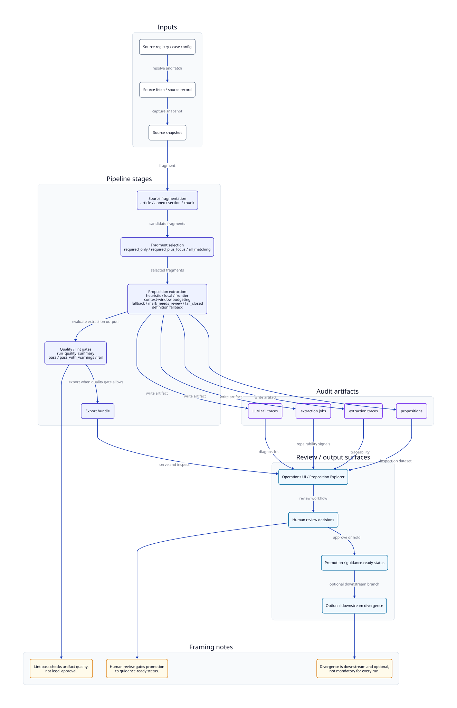

# Law Proposition Extractor pipeline overview

This pipeline transforms legal text into structured, reviewable legal propositions.

Diagram source: `docs/assets/diagrams/pipeline-overview-v2.d2` (generated SVG may be absent in a clean checkout; run `just diagrams`).

## Summary

Law Proposition Extractor processes legal text through a **source-first, proposition-first**, **deterministic-first** pipeline with **controlled model usage**. Language models run only in explicitly defined stages; assisted work is traceable in run artifacts.

At the product level, analysis proceeds **Source → Propositions → Legal structure → Comparison → Review**: ingest and anchor **sources**, extract and inventory **propositions**, build groups / typed relationships / effective-law context, use completeness and source categorisation for **context**, optionally run **divergence** classification to **compare** aligned propositions, then assemble templated outputs for human **review**.

Stages build on each other: intake and proposition work establish comparable units grounded in sources; middle stages classify structure, completeness, legal relationships, and divergence; export attaches effective-law and Proposition Matcher candidates; the final stage turns structured results into reviewable Workbench material (including DecisionExplanations).

For the explainability-oriented stage table (selection through Workbench), see [Explainability pipeline](../explainability/pipeline.md).

## Pipeline stages

| Stage | What it does | Model usage |
| ----- | ------------ | ----------- |
| Source intake | Fetch, parse, and register sources | No model |
| Proposition extraction | Extract candidate legal propositions (includes frontier selection + structured-list reconciliation) | Local/frontier model (controlled, cached) or heuristic |
| Proposition normalisation | Classify tier/effect, territory, labels, relationship keys (deterministic) | No model |
| Legal structure export | Legal rule groups, typed relationships, effective-law statements, Proposition Matcher candidates, decision explanations | No model |
| Proposition inventory and pairing | Group and align propositions | No model |
| Proposition completeness | Assess whether propositions are self-contained | Deterministic rules |
| Source categorisation | Assign roles and relationships between sources | Deterministic rules |
| Divergence classification | Classify differences between propositions | Optional frontier model (traceable) |
| Narrative output / Workbench review | Generate reports using templates; human review | No model (human review) |

## Design principles

- **Deterministic-first pipeline** with **controlled model usage**, per [ADR-0019: Model usage strategy](../decisions/adr-0019-model-usage-strategy.md)
- Source intake, **proposition normalisation**, proposition inventory and pairing, proposition completeness, source categorisation, and narrative output are deterministic or template-based
- See [Proposition classification](proposition-classification.md) for tiers, legal effects, territory fields, and relationship keys
- Proposition extraction may use a local model; divergence reasoning may optionally use a frontier model; both are traceable
- All outputs are source-backed
- Human review is first-class
