# Law Proposition Extractor visual explainability suite

Meeting-script index for the Law Proposition Extractor explainability diagrams. Diagrams complement
this handbook; they do not replace [pipeline](pipeline.md),
[concepts](concepts.md), or the [Article 49a walkthrough](article-49a-walkthrough.md).

**Sources:** `docs/assets/diagrams/explainability/*.d2`  
**Rendered SVGs (committed):** `docs/assets/generated/diagrams/explainability/*.svg`

```bash
just generate-explainability-diagrams
just check-explainability-diagrams
# or via the handbook commands:
just generate-explainability-docs
just check-explainability-docs
```

Generation is offline: no network, no LLM. Article 49a nodes are derived from the
acceptance fixture; divergence status labels come from
`divergence-implementation-status.json`.

---

## Law Proposition Extractor system map


### What it shows

Where Law Proposition Extractor sits between Law Discovery (source register), human review, and Proposition Matcher
(guidance comparison), with external authorities and an optional divergence branch.

### 30-second explanation

Law Discovery finds and registers sources. Law Proposition Extractor consumes snapshots and models legal rules.
The Workbench supports human review. Proposition Matcher compares **reviewed** law with
guidance — neither Law Proposition Extractor nor Proposition Matcher publishes law without review.

### Five-minute explanation

Walk left-to-right: external authorities → Law Discovery register → Law Proposition Extractor intake →
proposition/legal-structure pipeline → Workbench with reviewers → reviewed
effective-law output → Proposition Matcher. Call out the optional divergence branch as a
Law Proposition Extractor mode, not a replacement for single-jurisdiction inventory. Stress that
outputs remain reviewable evidence, not automatic authority.

### Important cautions

- Reviewed ≠ automatically authoritative.
- Divergence is optional and downstream of propositions.
- Do not imply Proposition Matcher invents or publishes law.

### Related documentation

- [Handbook index](README.md)
- [System overview](../architecture/system-overview.md)
- [Human review ADR](../decisions/adr-0010-human-review-in-core-workflow.md)

**Audience:** product stakeholders, lawyers, developers  
**Authorship:** hand-authored D2

---

## Source-to-statement pipeline



### What it shows

The current stage order from `SourceRecord` to Workbench review, with method
encoding for configuration, deterministic processing, LLM proposal, and human
review — plus the critical model/deterministic boundary.

### 30-second explanation

Law Proposition Extractor selects structural fragments, asks a language model to **propose** atomic
propositions, then deterministic stages validate, classify, group, link, and
compose reviewer-facing context. Humans review in the Workbench.

### Five-minute explanation

Trace each box in order. Pause on the red **CRITICAL BOUNDARY**: the model does
not finalise frontier selection, classification, groups, typed relationships, or
effective-law context. Use the legend (shape + `[CFG]`/`[DET]`/`[LLM]`/`[HUM]`
labels) so the story works in greyscale or print.

### Important cautions

- Not all extraction is deterministic; not all downstream work is LLM reasoning.
- Deterministic post-processing does not prove substantive legal correctness.
- Optional divergence reasoning is separate from extraction.

### Related documentation

- [Pipeline](pipeline.md)
- [Heuristics](heuristics.md)
- [Architecture pipeline overview](../architecture/pipeline-overview.md)

**Audience:** developers, auditors, lawyers  
**Authorship:** hand-authored D2

---

## Legal-structure data model



### What it shows

How `SourceFragment`, `Proposition`, `LegalRuleGroup`, typed vs generic
relationships, `EffectiveLawStatement`, `RequiredContext`, and
`DecisionExplanation` relate — with cardinalities in plain English.

### 30-second explanation

Fragments are structural text. Propositions are atomic retained rules. Groups
bundle propositions that share a fragment for targeting. Typed relationships
(`exception_to`, `triggered_by`) are not ordinary locator references. Statements
present propositions with required context; decision explanations record how they
were built.

### Five-minute explanation

Walk the core object chain, then the relationship panel. Emphasise: a proposition
may source a typed relationship; targets may be propositions or groups; typed
edges produce required context on statements. Keep generic locator edges visually
separate from typed legal relationships.

### Important cautions

- Do not merge generic locator edges with typed legal relationships.
- Legal rule groups ≠ duplicate-matching groups.
- Decision explanations are process evidence, not chain-of-thought.

### Related documentation

- [Concepts](concepts.md)
- [Glossary](glossary.md)
- [Artifacts and lineage](artifacts-and-lineage.md)

**Audience:** lawyers, developers, auditors  
**Authorship:** hand-authored D2

---

## Source version and legal-effect provenance



### What it shows

The four provenance boundaries: retrieval time vs legal as-of; revised
manifestation vs independently applied amendments; source-effect annotation vs
consumed affecting instrument; consumed instrument vs verified application.

### 30-second explanation

Law Proposition Extractor records exactly which snapshot bytes it consumed and how the publisher
labelled that manifestation. Source-effect annotations are what the XML reported.
Whether Law Proposition Extractor separately consumed an affecting instrument is a different question
— and even consumption is not verification that amendments were applied.

### Five-minute explanation

Walk panels A → B → C, then the four red ≠ boundaries. Call out implemented
status enums only (`OutstandingEffectsStatus`,
`AffectingInstrumentConsumptionStatus`, manifestation types). Stress that revised
text is not necessarily complete.

### Important cautions

- `retrieved_at` / cache `version_id` ≠ legal as-of date.
- Outstanding-effects status is separate from manifestation type.
- Never say “amendments applied” from manifestation alone.

### Related documentation

- [Concepts — required distinctions](concepts.md#required-distinctions)
- [Artifacts and lineage](artifacts-and-lineage.md)
- [ADR-0009 source provenance](../decisions/adr-0009-source-provenance-version-awareness.md)

**Audience:** lawyers, auditors, developers  
**Authorship:** hand-authored D2

---

## Article 49a walkthrough



### What it shows

Generated from the offline Article 49a acceptance bundle: hierarchy, extraction
frontier, six semantic propositions, groups, typed relationships, effective-law
projection, Article 14 as ordinary reference, and the E2 method sequence.

### 30-second explanation

Paragraph 1 has two rules (P1, P2). Paragraph 2 has three derogations (E1–E3)
that each except the paragraph-1 group. Paragraph 3 (P3) is triggered by the
paragraph-2 group. Article 14 is an ordinary reference on E3 — not an exception
target.

### Five-minute explanation

1. Hierarchy and frontier (parent/2(a) suppressed; paragraphs 1–3 selected).  
2. Six roles without opaque IDs.  
3. Groups (2 + 3 members) and `exception_to` / `triggered_by`.  
4. Effective-law context expansion.  
5. E2 sequence: model proposal → deterministic composition → classification →
   exception → group expansion.

### Important cautions

- Fixture is an offline regression slice, not authoritative current law.
- Opaque live IDs are intentionally omitted from labels.
- Human review remains required.

### Related documentation

- [Article 49a walkthrough](article-49a-walkthrough.md)
- Fixture: `tests/fixtures/article_49a_legal_structure/`
- Acceptance helper: `article_49a_legal_structure_acceptance.py`

**Audience:** lawyers, policy specialists, developers, auditors  
**Authorship:** generated D2 from fixture (layout authored in generator)

---

## Legal divergence workflow



### What it shows

Common source family → proposition/effective-law comparison path → Proposition Matcher,
with divergence mechanisms labelled by implementation status (`[IMPL]` /
`[PARTIAL]` / `[PLANNED]`).

### 30-second explanation

EU/UK comparison is built on aligned propositions and effective-law statements,
not document redlines. Some mechanism types are already heuristically classified;
others exist only as planned enum values — the diagram labels that truthfully.

### Five-minute explanation

Start from the shared baseline / EU / UK family. Walk the process chain. Then use
the status legend to separate current `compare.py` heuristics from planned
mechanisms (`dynamic-reference`, `territorial`, `revocation/replacement`) and
planned review stages (scope-resolution, guidance eligibility).

### Important cautions

- Do not claim all mechanism types are fully implemented.
- Divergence can arise from the wider legal environment, not only wording.
- Status tags come from `divergence-implementation-status.json`.

### Related documentation

- [ADR-0006 proposition-level comparison](../decisions/adr-0006-proposition-level-comparison-unit.md)
- [ADR-0015 workflow modes](../decisions/adr-0015-workflow-modes-single-jurisdiction-and-divergence.md)
- [Pipeline — optional divergence](pipeline.md)
- Manifest: `docs/assets/diagrams/explainability/divergence-implementation-status.json`

**Audience:** product stakeholders, lawyers, developers  
**Authorship:** mixed (hand-authored layout + generated status block)

---

## Presentation modes

| Mode | Guidance |
| --- | --- |
| Screen (MkDocs) | SVGs use `--scale=1` and readable 12–16px labels; zoom sparingly. |
| Print (A4 landscape) | Prefer pipeline, provenance, and Article 49a one-at-a-time; greyscale still encodes method via shape + `[CFG]`/`[DET]`/`[LLM]`/`[HUM]`. |
| Slides (16:9) | Reuse SVGs as full-bleed figures; keep speaker notes from the 30-second / five-minute scripts above. |

Do not rely on hover-only information — every critical distinction is in visible labels.
